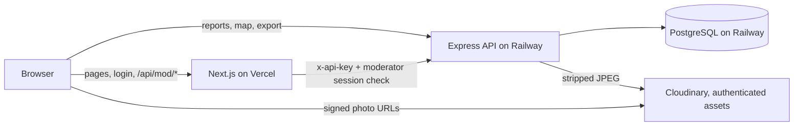

# TapCheck build notes

Owner: Executive Coder. Branch `feat/port-nextjs-railway`: the `feat/mvp-scaffold` draft ported to the stack in `docs/PLAN.md` (Next.js on Vercel, Express on Railway, PostgreSQL via Prisma, Cloudinary photos). Not production-ready; for review.

## Layout
```
api/                      Express API (Railway service, root directory = api)
  prisma/schema.prisma    reports, status_history, moderators
  prisma/migrations/      SQL migrations (apply with `npm run migrate`)
  src/app.js              routes, validation, rate limits, CSV/GeoJSON export
  src/photo.js            JPEG metadata stripping (EXIF/GPS, XMP, IPTC, comments) before upload
  src/photos.js           Cloudinary store: "authenticated" uploads, signed delivery URLs
  src/index.js            server entry point
  scripts/create-moderator.js  bcrypt-hashed moderator account
  test/app.test.js        node:test suite against a real PostgreSQL
web/                      Next.js 16 App Router (Vercel project, root directory = web)
  app/report              report form: 3 quick questions, GPS or pin drop, photo, private email, disclaimer
  app/map                 public map: clustered markers, type/age filters, photo popups, export links
  app/dashboard           public status counts (server-rendered)
  app/login, app/mod      moderator login (NextAuth credentials) and triage queue
  app/api/mod/...         session-checked proxy to the API's moderator routes
  app/api/auth/...        NextAuth
  proxy.js                redirects signed-out visitors of /mod to /login (Next 16 replacement for middleware)
  lib/queue.js            offline queue (localStorage, client UUID makes retries idempotent)
  public/sw.js            service worker: report/map/dashboard pages load offline
```

## How the pieces talk

- Public calls go straight from the browser to the API, so the API sees the real client IP for rate limits. CORS allows only `FRONTEND_ORIGIN`.
- Moderator calls go through Next.js: it checks the NextAuth session, then adds `INTERNAL_API_KEY`. The key never reaches the browser.

## Run locally
Needs Node 20+ and a PostgreSQL database (for example `docker run -d -p 5432:5432 -e POSTGRES_PASSWORD=password postgres:16-alpine`).

```bash
# API
cd api && cp .env.example .env    # fill DATABASE_URL and INTERNAL_API_KEY
npm install && npm run migrate
npm run create-moderator -- mod@example.org '<12+ character password>'
npm start                          # http://localhost:4000

# Web (second terminal)
cd web && cp .env.example .env.local   # same INTERNAL_API_KEY, plus NEXTAUTH_SECRET
npm install && npm run build && npm start   # http://localhost:3000

# Tests (use a disposable database; the suite deletes all rows)
cd api && DATABASE_URL=postgresql://.../tapcheck_test npx prisma migrate deploy && DATABASE_URL=... npm test
```
Without Cloudinary credentials the API still accepts reports and drops their photos (logged at start-up).

## API
| Method | Path | Auth | Notes |
|---|---|---|---|
| POST | `/api/reports` | none (CORS) | `{id (uuid), issue_type, severity 1-3, duration, water_usable, lat, lng, description?, contact_email?, photo? (JPEG data URL)}`; 201 with `remaining`, 200 duplicate, 429 over a limit |
| GET | `/api/reports` | none | Non-rejected reports, newest 1000; coarse location; signed photo URL; no email, note or exact GPS |
| GET | `/api/stats` | none | Counts by status + last update |
| GET | `/api/export?format=csv\|geojson` | none | Same public fields as the map; CSV is formula-safe |
| POST | `/api/auth/verify` | `x-api-key` | Used by NextAuth; bcrypt check; 5 failures per email per 15 min → 429 |
| GET | `/api/mod/reports` | `x-api-key` | All reports with exact GPS, email, note, status history |
| GET | `/api/reports/:id` | `x-api-key` | Moderator detail |
| PATCH | `/api/reports/:id` | `x-api-key` | `{status, note}`; writes `status_history` |

Limits: 10 report submissions per IP per minute (PLAN.md) and 5 per device (hashed IP + User-Agent) per 24 h (Security Reviewer). Requests carrying the internal key are exempt.

## MVP coverage (docs/MVP.md)
| Feature | State |
|---|---|
| 1. Report form + offline | Ported: all fields, browser-side resize to 1280 px JPEG, server-side metadata strip, soft warning, offline queue, service worker |
| 2. Public map | Ported: react-leaflet + markercluster, status colors, filters, popups, ~100 m coarse location |
| 3. Moderator triage | Ported: NextAuth credentials backed by the `moderators` table (bcrypt), sort, actions, internal note, exact GPS moderator-only |
| 4. Export | Ported: CSV and GeoJSON (one `/api/export` route with `format`, as in PLAN.md) |
| 5. Status dashboard | Ported (server-rendered) |

Deviations from the docs: Next.js **16** instead of the 14 named in MVP.md, because 14.x is out of support and `npm audit` lists unpatched critical advisories (including remote code execution) for it. JavaScript, not TypeScript, to match the draft.

## Hosting (PLAN.md: Vercel + Railway + Cloudinary)
Prices checked 2026-11-12 at vercel.com/pricing, railway.com/pricing and cloudinary.com/pricing; totals are estimates.

| Piece | Plan | Rough monthly cost |
|---|---|---|
| Next.js on Vercel | Hobby $0 (check its non-commercial terms for a nonprofit pilot) or Pro $20 | $0–20 |
| Express API on Railway | Hobby: $5 fee includes $5 of usage; memory ≈ $10/GB-month, CPU ≈ $20/vCPU-month | $5–10 together with Postgres |
| PostgreSQL on Railway | Same project; volume ≈ $0.15/GB-month | (included above) |
| Cloudinary | Free: 25 credits/month (1 credit = 1 GB storage, 1 GB bandwidth or 1,000 transformations) | $0 at pilot scale |
| **Total** | | **about $5–10 (Vercel Hobby) or $25–30 (Vercel Pro)** |

Deploy steps:
1. Railway: new project → PostgreSQL service + a service from this repo with root `api`, start `npm run migrate && npm start`; set `DATABASE_URL` (reference the Postgres service), `INTERNAL_API_KEY`, `FRONTEND_ORIGIN` (the Vercel URL), Cloudinary vars, `RATE_SALT`.
2. Run `npm run create-moderator` once from a Railway shell.
3. Vercel: import the repo with root `web`; set `NEXT_PUBLIC_API_URL` (public Railway URL), `API_URL`, `INTERNAL_API_KEY`, `NEXTAUTH_SECRET`, `NEXTAUTH_URL`.

Not verified: whether Cloudinary's Free plan allows "authenticated" delivery with signed URLs (the pricing page lists "Authentication Options" under Advanced; that may refer only to token-based auth). Check on the first real upload; if blocked, switch `type` to `upload` in `api/src/photos.js` and accept that photo URLs are public once known.

## Next build steps
1. Real Cloudinary and Railway deploy (needs the team's accounts).
2. Design Critic items: list view for screen readers, split-view triage, undo toast.
3. Lighthouse mobile audit (target ≥ 80).
4. Per-moderator accounts are supported by the schema; add an admin flow if the pilot needs more than one login.
